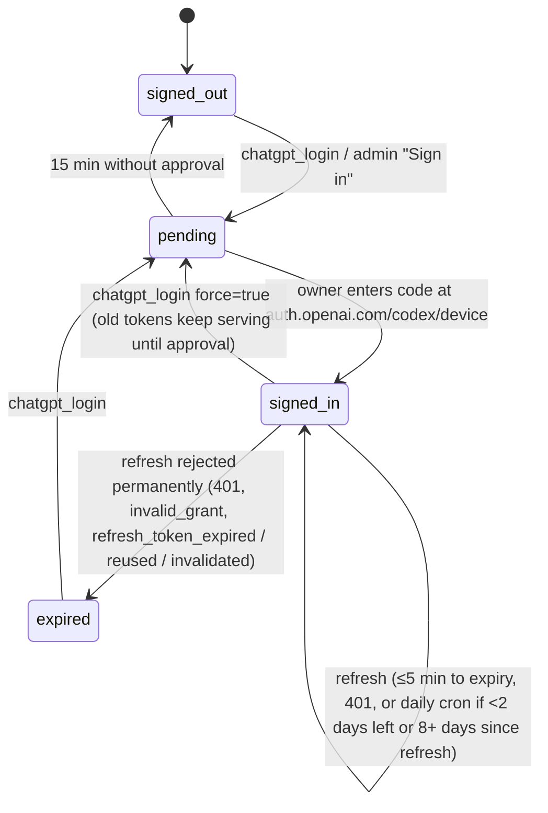

# openai-web-mcp

A remote MCP server on Cloudflare Workers that gives Claude (or any MCP client) **live web search and page reading through your ChatGPT login**. It calls `chatgpt.com/backend-api/codex/alpha/search`, the endpoint behind the Codex CLI's own `web.run` tool. Background, evidence and live probe results: [`hermes-reverse-engineering/findings/05-openai-search-for-claude.md`](../../hermes-reverse-engineering/findings/05-openai-search-for-claude.md).

| Tool | Replaces | Upstream command |
|---|---|---|
| `web_search(query, limit=8, domains?, recency_days?, extra_queries?)` | WebSearch | `search_query` |
| `web_fetch(url, line?, find?, max_tokens=6000)` | WebFetch | `open` / `find`. Falls back to a direct fetch + HTML→text when upstream can't open the page |
| `chatgpt_login(force=false)` | — | Kite-style sign-in: returns a link + one-time code; call again to confirm |
| `web_status()` | — | login state + today's usage |

```
src/index.ts    OAuth provider (/authorize, /oauth/*), /mcp, /admin, /health, cron
src/auth.ts     owner-passphrase consent (from the YouTube Research worker), per-kind login rate limits
src/vault.ts    TokenVault Durable Object: own device-code login, single-flight refresh, cron keep-fresh
src/codex.ts    alpha/search client + output cleanup (cite markers, 【n†link】, Lnn: lines, paging)
src/service.ts  search/fetch orchestration, daily cap, 401→refresh→retry once, direct-fetch fallback
src/url.ts      SSRF guard for user-supplied URLs
src/admin.ts    owner pages: ChatGPT sign-in, status, /admin/reachability
reachability/   throwaway, binding-free probe worker (`npm run reachability`)
```

## Login lifecycle (how ChatGPT login expiry is handled)



- **Access-token expiry (routine):** refreshed automatically, one refresh at a time. Users see nothing.
- **Refresh token dead** (password change, "log out all devices", revoked, reused, idle too long): the vault moves to `expired` with the reason. Every tool then returns `LOGIN_REQUIRED` with a `next_step` that tells Claude to call `chatgpt_login`. Claude shows you the link and code; you approve on your phone or laptop; Claude calls `chatgpt_login` again to confirm. `web_fetch` keeps working through the direct fallback in the meantime.
- **Transient refresh errors** (5xx, other 400s) keep the login and are retried on the next call, matching Codex.
- **Proactive refresh:** the daily cron refreshes when under 2 days remain or the last refresh is 8+ days old (Codex's `TOKEN_REFRESH_INTERVAL`), so an unused server doesn't let the grant go stale.
- You only find out about an expiry when a tool is called or you open `/admin`. There is no push alert yet.

## Security model

- `/mcp` requires OAuth (`mcp:read`). The consent page asks for `OWNER_PASSPHRASE`.
- `/admin` uses HTTP Basic auth: user `owner`, password `OWNER_PASSPHRASE`. Only failed attempts count toward the 20-per-hour limit.
- The ChatGPT tokens live only in the `TokenVault` Durable Object. The Worker does its **own** device-code login, so it never copies `~/.codex/auth.json`. Refresh tokens are single-use, and sharing one would sign your Codex CLI out.
- It identifies itself as `originator: openai-web-mcp`. It never impersonates the Codex CLI.
- `web_fetch` blocks private, loopback, link-local and metadata hosts. The `global_fetch_strictly_public` compatibility flag enforces the same at runtime.
- `DAILY_LIMIT` (default 400) caps upstream calls per UTC day.

## Deploy

```bash
npm install
```
```bash
npx wrangler login
```
```bash
npm run reachability
```
Then open `http://localhost:8799` and expect `"verdict": "REACHABLE"`; a JSON 401 from `alpha/search` is the good case. If it says `BLOCKED_OR_ERROR` with `challenged: true`, Cloudflare bot management is blocking Worker egress to chatgpt.com. See the Render fallback in the findings doc, §6.

```bash
npx wrangler d1 create openai-web-mcp
```
```bash
npx wrangler kv namespace create OAUTH_KV
```
Paste both ids into `wrangler.jsonc`, then:
```bash
npx wrangler d1 migrations apply openai-web-mcp --remote
```
```bash
openssl rand -base64 36 | npx wrangler secret put OWNER_PASSPHRASE
```
Store that passphrase in your password manager *before* piping it (or generate it there and paste it at the prompt).
```bash
npm test && npx wrangler deploy
```

Then open `https://openai-web-mcp.gmathur1993.workers.dev/admin` and choose **Sign in with ChatGPT**. Enter the code it shows at `auth.openai.com/codex/device`. After that, `/admin/reachability?live=1` runs one real search.

## Use it from Claude

Claude Code:
```bash
claude mcp add --transport http openai-web https://openai-web-mcp.gmathur1993.workers.dev/mcp
```
Then make Claude use these tools instead of the built-in ones, in `~/.claude/settings.json`:
```json
{ "permissions": { "deny": ["WebSearch", "WebFetch"] } }
```
Claude Desktop / claude.ai: add the same `/mcp` URL as a custom connector and turn off the built-in web search toggle.

## Develop

```bash
npm run check
```
```bash
npm test
```
The integration tests run the built Worker in miniflare against a fake OpenAI (device login, refresh race, 401 retry, fallback, SSRF, daily cap). Miniflare listens on a local port. In the Claude Code sandbox that needs `sandbox.network.allowLocalBinding: true`.

## Configuration reference

**Server settings** (`wrangler.jsonc` vars / secrets)

| Setting | Values | Current | Why |
|---|---|---|---|
| `OWNER_PASSPHRASE` (secret) | ≥ 32 chars | you generate it | Gates MCP consent and `/admin`. |
| `PUBLIC_ORIGIN` | URL | `https://openai-web-mcp.gmathur1993.workers.dev` | OAuth issuer and resource must equal the deployed origin. |
| `DAILY_LIMIT` | ≥ 1 upstream calls per UTC day | `400` | Protects your ChatGPT quota. Plan limits for `alpha/search` are unpublished. Search and fetch both count. |
| `CODEX_MODEL` | any string; **not validated** (a made-up id gave identical results) | `gpt-5.4-mini` | The field is required. A real Codex id keeps working if OpenAI starts validating it. |
| `SEARCH_COUNTRY` / `SEARCH_CITY` / `SEARCH_TIMEZONE` | ISO-3166 alpha-2 / city / IANA tz; unset = global | `IN` / — / `Asia/Kolkata` (owner's choice, 2026-11-10) | **Big effect:** "filter coffee near me" went from global blogs to Bengaluru cafés and Swiggy. |
| `BLOCKED_DOMAINS` | comma list, ≤ 100 hosts | unset | Always-excluded sites (`filters.blocked_domains`, verified). |
| cron | cron expr | `17 3 * * *` (daily) | Token keep-fresh + table cleanup. |

**Tool parameters** (Claude sets per call)

| Tool · param | Range | Default | Notes |
|---|---|---|---|
| `web_search.query` | 1–400 chars | — | |
| `web_search.limit` | 1–20 | 8 | Sets the token budget: `clamp(limit×250, 1500, 8000)`. Live: 1000 → 1, 2500 → 10, 5000 → 25 results. |
| `web_search.domains` | ≤ 5 hosts | none | Per-query `domains` (applies to `query` only). |
| `web_search.exclude_domains` | ≤ 20 hosts | none | Merged with `BLOCKED_DOMAINS`. |
| `web_search.recency_days` | 1–3650 | none | Per-query `recency`. |
| `web_search.extra_queries` | ≤ 3 | none | Upstream allows at most 4 queries per call. |
| `web_search.country` / `city` | ISO-2 or `global` / text | server default | A per-call country replaces the default city and timezone. |
| `web_fetch.url` | public http(s) | — | Private, loopback and metadata hosts are refused. |
| `web_fetch.line` | ≥ 0 | 0 | Pass `next_line`. Upstream windows start on chunk boundaries (`lineno` 200 → L120–205), so the Worker trims to `line`. |
| `web_fetch.find` | 1–200 chars | none | Returns the window around matches. |
| `web_fetch.max_tokens` | 1000–12000 | 6000 | About 4 chars per token, so ~24k chars per page window. |
| `chatgpt_login.force` | bool | false | `true` replaces a working login (switch account). |

**Upstream request fields** (fixed in code)

| Field | Values | Sent | Why |
|---|---|---|---|
| `settings.external_web_access` | `true` / `false` / `"indexed"` | `true` | Codex maps `true` = live. Live probe: no visible difference across the three (`"indexed"` was ~2× slower). |
| `settings.search_context_size` | `low` / `medium` / `high` | not sent | No visible difference live; `max_output_tokens` dominates. |
| `settings.allowed_callers` | `["direct"]` | `["direct"]` | What Codex sends. |
| `settings.user_location` | approximate {country, city, region, timezone} | from config/tool | Verified: strong localisation. |
| `settings.filters.blocked_domains` | ≤ 100 hosts | from config/tool | Verified. |
| `settings.filters.allowed_domains` | ≤ 100 hosts | not used | Very strict live (1 result); the per-query `domains` is used instead. |
| `max_output_tokens` | int | search: `clamp(limit×250,1500,8000)`; fetch: `max_tokens` | Controls both output size and result count. |
| `id` (session) | string | search: random UUID; fetch: UUID from SHA-256(url) | Same `id` keeps `turnNviewM` refs, so `lineno` and `find` work across calls. |

**Internal constants**

| Constant | Value | Why |
|---|---|---|
| Refresh skew | 300 s | Codex refreshes 5 min before expiry (Hermes uses 120 s). |
| Refresh interval | 8 days | Codex `TOKEN_REFRESH_INTERVAL`. |
| Keep-fresh margin | 2 days | The cron refreshes early, so a daily run never misses expiry. |
| Login code window | 15 min | Hermes waits 15 min for device approval. |
| Poll interval | max(3 s, server `interval`) | Hermes floor. |
| Upstream timeout | 60 s | Hermes `_TIMEOUT`. Live calls took 2.4–5.5 s. |
| Fallback fetch | 20 s, 4 redirects, 3 MB, HTML/text only | Bounded Worker CPU and memory. |
| Login attempt limits | consent 10/h/IP; admin failures 20/h/IP | Brute-force protection. |
| MCP OAuth tokens | access 1 h, refresh 30 days (idle 30 days) | Clients re-authorise monthly if unused. |

## Status: Cloudflare-only does not work (2026-11-10)

`npm run reachability` showed that **chatgpt.com blocks Cloudflare Workers' egress IPs** (HTTP 403 HTML "Unable to load site" in 8 ms, while the same request from a normal network gets a JSON 401). `auth.openai.com` is reachable, so login and refresh work, but `alpha/search` cannot be called from a Worker. The Worker is therefore **not deployed**. The search call needs to leave from a different network, e.g. a small free Render relay (see the findings doc, §12).

## Known limits

- `alpha/search` is undocumented and unversioned, and OpenAI can change or remove it.
- Signed in with the owner's **main** ChatGPT account (owner's choice, 2026-11-10). Searches share that account's usage limits, and any action OpenAI takes over use of the undocumented endpoint would hit that account. Keep `DAILY_LIMIT` conservative.
- Searches count against your ChatGPT plan limits. Verified working on a **free** plan, 2026-11-10.
- `finance` (not exposed as a tool) has no Indian equities.
- `lineno` windows start on upstream chunk boundaries. The Worker trims to your requested `line` and returns `next_line`.
